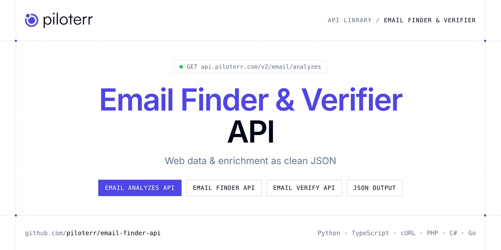

<p align="center">
  <a href="https://www.piloterr.com"></a>
</p>

# Email Finder & Verifier API

[](https://discord.gg/CFj3ph8aHU) [](https://app.piloterr.com) [](https://app.piloterr.com/openapi) [](LICENSE)

The **Piloterr Email Finder & Verifier API** lets you extract public data from Email Finder & Verifier as **clean, structured JSON** — no proxies, headless browsers or HTML parsing to maintain. Endpoints available in production:

- **Email Analyzes API** — Analyze a domain to retrieve its email infrastructure.
- **Email Finder API** — Find verified professional email addresses by combining a person's full name with their company domain or company name.
- **Email Verify API** — Verify whether an email address is valid and deliverable, returning a clear status to prevent bounces and maintain list hygiene.

Use it to render, unlock, crawl or enrich any website or domain without running your own scraping infrastructure.

| Endpoint | Path | Credits | What you get |
|---|---|---|---|
| [Email Analyzes API](#email-analyzes-api) | `/v2/email/analyzes` | 1 | Analyze a domain to retrieve its email infrastructure. Microsoft 365 and Google Workspace domains, SPF records, and DNS configurations. |
| [Email Finder API](#email-finder-api) | `/v2/email/finder` | 1 | Find verified professional email addresses by combining a person's full name with their company domain or company name. |
| [Email Verify API](#email-verify-api) | `/v2/email/verify` | 1 | Verify whether an email address is valid and deliverable, returning a clear status to prevent bounces and maintain list hygiene. |

## Table of contents

- [How it works](#how-it-works)
- [Email Analyzes API](#email-analyzes-api)
- [Email Finder API](#email-finder-api)
- [Email Verify API](#email-verify-api)
- [Code examples in other languages](#code-examples-in-other-languages)
- [Practical use cases](#practical-use-cases)
- [Why Piloterr?](#why-piloterr)
- [FAQ](#faq)
- [Related scrapers](#related-scrapers)
- [Support](#support)

## How it works

1. **Create a free Piloterr account** and copy your API key from the [dashboard](https://app.piloterr.com).
2. **Send a `GET` (or `POST`) request** to `https://api.piloterr.com/v2/...` with the header `x-api-key: YOUR_API_KEY`.
3. **Receive structured JSON** — Piloterr handles rendering, proxies, retries and parsing.

```bash
export PILOTERR_API_KEY="your-api-key"
pip install requests        # Python
# TypeScript: Node.js 18+ (native fetch), run with `npx tsx file.ts`
```

> Every endpoint accepts both `GET` (query string) and `POST` (JSON body with the same fields).

## Email Analyzes API

Analyze a domain to retrieve its email infrastructure. Microsoft 365 and Google Workspace domains, SPF records, and DNS configurations.

`GET | POST https://api.piloterr.com/v2/email/analyzes` · **1 credit per request** · [Full reference](https://app.piloterr.com/openapi)

### Request parameters

| Parameter | Type | Required | Description |
|---|---|---|---|
| `query` | string | ✅ | The domain name you want to analyze for email infrastructure. |

### Python example

```python
import json
import os
import requests

response = requests.get(
    "https://api.piloterr.com/v2/email/analyzes",
    headers={"x-api-key": os.environ["PILOTERR_API_KEY"]},
    params={
        "query": "airbus.com",
    },
    timeout=60,
)
response.raise_for_status()
data = response.json()

print(json.dumps(data, indent=2, ensure_ascii=False)[:2000])
```

### TypeScript example

```typescript
type EmailAnalyzes = {
  domains?: {
    "airbus.com"?: string[];
    "apsys-airbus.com"?: string[];
    "airbus.onmicrosoft.com"?: string[];
    "globalemail.airbus.com"?: unknown[];
    "airbus.mail.onmicrosoft.com"?: string[];
  };
  is_microsoft_365?: boolean;
  is_google_workspace?: boolean;
  microsoft_365_domains?: string[];
  google_workspace_domains?: unknown[];
};

const params = new URLSearchParams({
  "query": "airbus.com",
});

const response = await fetch(`https://api.piloterr.com/v2/email/analyzes?${params}`, {
  headers: { "x-api-key": process.env.PILOTERR_API_KEY! },
});
if (!response.ok) throw new Error(`Piloterr error ${response.status}: ${await response.text()}`);

const data = (await response.json()) as EmailAnalyzes;

console.log(JSON.stringify(data, null, 2).slice(0, 2000));
```

<details>
<summary><b>POST variant</b></summary>

```http
POST https://api.piloterr.com/v2/email/analyzes
x-api-key: YOUR_API_KEY
Content-Type: application/json

{"query": "airbus.com"}
```
</details>

### Output example

Response shape with placeholder values — field names follow the API reference.

```json
{
  "domains": {
    "airbus.com": [
      "example"
    ],
    "apsys-airbus.com": [
      "example"
    ],
    "airbus.onmicrosoft.com": [
      "example"
    ],
    "globalemail.airbus.com": [
      "example"
    ],
    "airbus.mail.onmicrosoft.com": [
      "example"
    ]
  },
  "is_microsoft_365": false,
  "is_google_workspace": false,
  "microsoft_365_domains": [
    "example"
  ],
  "google_workspace_domains": [
    "example"
  ]
}
```

### Response fields

| Field | Type | Description |
|---|---|---|
| `domains` | object |  |
| `domains.airbus.com` | string[] |  |
| `domains.apsys-airbus.com` | string[] |  |
| `domains.airbus.onmicrosoft.com` | string[] |  |
| `domains.globalemail.airbus.com` | any[] |  |
| `domains.airbus.mail.onmicrosoft.com` | string[] |  |
| `is_microsoft_365` | boolean |  |
| `is_google_workspace` | boolean |  |
| `microsoft_365_domains` | string[] |  |
| `google_workspace_domains` | any[] |  |

## Email Finder API

Find verified professional email addresses by combining a person's full name with their company domain or company name.

`GET | POST https://api.piloterr.com/v2/email/finder` · **1 credit per request** · [Full reference](https://app.piloterr.com/openapi)

### Request parameters

| Parameter | Type | Required | Description |
|---|---|---|---|
| `query` | string | ✅ | Full name of the person whose professional email address you want to find. |
| `company_domain` | string | — | The company's domain name. Multiple formats are accepted: |
| `company_name` | string | — | The company name of the person you are looking for. |

### Python example

```python
import json
import os
import requests

response = requests.get(
    "https://api.piloterr.com/v2/email/finder",
    headers={"x-api-key": os.environ["PILOTERR_API_KEY"]},
    params={
        "query": "Jane Doe",
    },
    timeout=60,
)
response.raise_for_status()
data = response.json()

print(json.dumps(data, indent=2, ensure_ascii=False)[:2000])
```

### TypeScript example

```typescript
type EmailFinder = {
  email?: string;
  status?: string;
  last_name?: string;
  first_name?: string;
  company_domain?: string;
};

const params = new URLSearchParams({
  "query": "Jane Doe",
});

const response = await fetch(`https://api.piloterr.com/v2/email/finder?${params}`, {
  headers: { "x-api-key": process.env.PILOTERR_API_KEY! },
});
if (!response.ok) throw new Error(`Piloterr error ${response.status}: ${await response.text()}`);

const data = (await response.json()) as EmailFinder;

console.log(JSON.stringify(data, null, 2).slice(0, 2000));
```

<details>
<summary><b>POST variant</b></summary>

```http
POST https://api.piloterr.com/v2/email/finder
x-api-key: YOUR_API_KEY
Content-Type: application/json

{"query": "Jane Doe"}
```
</details>

### Output example

Response shape with placeholder values — field names follow the API reference.

```json
{
  "email": "example",
  "status": "example",
  "last_name": "example",
  "first_name": "example",
  "company_domain": "example"
}
```

### Response fields

| Field | Type | Description |
|---|---|---|
| `email` | string |  |
| `status` | string |  |
| `last_name` | string |  |
| `first_name` | string |  |
| `company_domain` | string |  |

## Email Verify API

Verify whether an email address is valid and deliverable, returning a clear status to prevent bounces and maintain list hygiene.

`GET | POST https://api.piloterr.com/v2/email/verify` · **1 credit per request** · [Full reference](https://app.piloterr.com/openapi)

### Request parameters

| Parameter | Type | Required | Description |
|---|---|---|---|
| `query` | string | ✅ | The email address you want to verify. |

### Python example

```python
import json
import os
import requests

response = requests.get(
    "https://api.piloterr.com/v2/email/verify",
    headers={"x-api-key": os.environ["PILOTERR_API_KEY"]},
    params={
        "query": "jane.doe@example.com",
    },
    timeout=60,
)
response.raise_for_status()
data = response.json()

print(json.dumps(data, indent=2, ensure_ascii=False)[:2000])
```

### TypeScript example

```typescript
type EmailVerify = {
  email?: string;
  status?: string;
};

const params = new URLSearchParams({
  "query": "jane.doe@example.com",
});

const response = await fetch(`https://api.piloterr.com/v2/email/verify?${params}`, {
  headers: { "x-api-key": process.env.PILOTERR_API_KEY! },
});
if (!response.ok) throw new Error(`Piloterr error ${response.status}: ${await response.text()}`);

const data = (await response.json()) as EmailVerify;

console.log(JSON.stringify(data, null, 2).slice(0, 2000));
```

<details>
<summary><b>POST variant</b></summary>

```http
POST https://api.piloterr.com/v2/email/verify
x-api-key: YOUR_API_KEY
Content-Type: application/json

{"query": "jane.doe@example.com"}
```
</details>

### Output example

Response shape with placeholder values — field names follow the API reference.

```json
{
  "email": "example",
  "status": "example"
}
```

### Response fields

| Field | Type | Description |
|---|---|---|
| `email` | string |  |
| `status` | string |  |

## Code examples in other languages

Ready-to-run examples live in the [`examples/`](examples) folder. Each one reads your key from the `PILOTERR_API_KEY` environment variable.

| Language | Email Analyzes | Email Finder | Email Verify |
|---|---|---|---|
| cURL (Bash) | [`analyzes`](examples/curl/analyzes.sh) | [`finder`](examples/curl/finder.sh) | [`verify`](examples/curl/verify.sh) |
| PHP | [`analyzes`](examples/php/analyzes.php) | [`finder`](examples/php/finder.php) | [`verify`](examples/php/verify.php) |
| C# | [`analyzes`](examples/csharp/Analyzes.cs) | [`finder`](examples/csharp/Finder.cs) | [`verify`](examples/csharp/Verify.cs) |
| Go | [`analyzes`](examples/go/analyzes.go) | [`finder`](examples/go/finder.go) | [`verify`](examples/go/verify.go) |
| Java | [`analyzes`](examples/java/AnalyzesExample.java) | [`finder`](examples/java/FinderExample.java) | [`verify`](examples/java/VerifyExample.java) |
| Ruby | [`analyzes`](examples/ruby/analyzes.rb) | [`finder`](examples/ruby/finder.rb) | [`verify`](examples/ruby/verify.rb) |
| Node.js | [`analyzes`](examples/nodejs/analyzes.mjs) | [`finder`](examples/nodejs/finder.mjs) | [`verify`](examples/nodejs/verify.mjs) |

## Practical use cases

- **Scraping any website** — Render JavaScript and unlock protected pages through one API.
- **Data enrichment** — Enrich domains, emails and companies in your pipelines.
- **Security & compliance** — Check domains against blocklists and threat sources.
- **Lead qualification** — Verify contacts and detect website technologies.
- **Automation** — Plug results into ETL, no-code tools and AI agents.

## Why Piloterr?

- **No infrastructure** — no proxies, headless browsers or CAPTCHA solving to run yourself.
- **Structured JSON** — stable, documented fields instead of brittle HTML selectors.
- **Pay per request** — transparent credit cost per endpoint, failed requests are retried for you.
- **One API key, hundreds of sources** — Email Finder & Verifier plus many other e-commerce, search and company data endpoints in the [Piloterr library](https://www.piloterr.com/library).
- **Any language** — plain HTTPS + JSON, with examples for Python, TypeScript, cURL, PHP, C#, Go, Java, Ruby and Node.js.

## FAQ

### Is it legal to scrape Email Finder & Verifier?

Collecting publicly available data is generally allowed in many jurisdictions, but rules depend on your country, the data you collect and how you use it. Avoid personal data unless you have a lawful basis, respect the website's terms where they apply, and get legal advice for your specific use case. This is not legal advice.

### Do I need proxies or a headless browser?

No. Piloterr handles rendering, proxy rotation and retries on its side. You only send an HTTPS request with your `x-api-key` header and receive JSON.

### How much does a request cost?

Credits per call: `/v2/email/analyzes` **1**, `/v2/email/finder` **1**, `/v2/email/verify` **1**. See the [Piloterr website](https://www.piloterr.com) for plans.

### What data does the Email Finder & Verifier API return?

Each endpoint returns structured JSON: **Email Analyzes** — `domains`, `domains.airbus.com`, `domains.apsys-airbus.com`, `domains.airbus.onmicrosoft.com`, `domains.globalemail.airbus.com`, `domains.airbus.mail.onmicrosoft.com`; **Email Finder** — `email`, `status`, `last_name`, `first_name`, `company_domain`; **Email Verify** — `email`, `status`.

### Which languages are supported?

Any language that can make an HTTP request. This README shows Python and TypeScript; the [`examples/`](examples) folder contains cURL, PHP, C#, Go, Java, Ruby and Node.js.

## Related scrapers

- [Domain Intelligence API](https://github.com/piloterr/domain-lookup-api)
- [Website Scraping API](https://github.com/piloterr/website-scraper-api)
- [All Piloterr scrapers on GitHub](https://github.com/piloterr)

## Support

- 💬 Join the [Piloterr Discord](https://discord.gg/CFj3ph8aHU) to ask questions and share what you build.
- 📚 Browse the [API reference (OpenAPI)](https://app.piloterr.com/openapi) and the [Piloterr library](https://www.piloterr.com/library).
- 🔑 [Get your API key](https://app.piloterr.com).

---

<p align="center">
  <a href="https://www.piloterr.com">
    <picture>
      <source media="(prefers-color-scheme: dark)" srcset="images/logo-dark.svg">
      
    </picture>
  </a>
  <br>
  <sub>Built by <a href="https://www.piloterr.com">Piloterr</a> — web scraping APIs for e-commerce, search, real estate and more, one API key.</sub>
</p>

<sub>Email Finder & Verifier is a trademark of its respective owner. This repository is not affiliated with or endorsed by Email Finder & Verifier. Examples are released under the MIT license.</sub>
